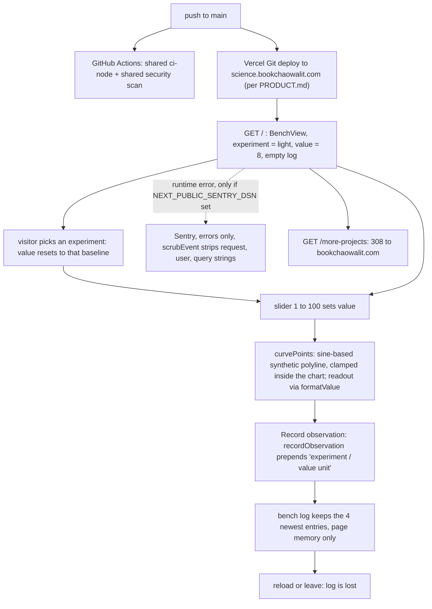

# 01 — Business process (As-Is / To-Be)

education-science-bench-web คือหน้าเว็บฝั่ง browser ล้วน (science.bookchaowalit.com) ให้ผู้เยี่ยมชมเลือกการทดลองสังเคราะห์ 3 แบบ เลื่อน slider ดูเส้นโค้งที่คำนวณจากสูตรคงที่ และบันทึกผลสังเกตลง log ในหน่วยความจำของหน้า

Last reviewed: 2026-11-28 · commit `659c5bd`

## As-Is (จากโค้ดวันนี้)

Sources: `app/page.tsx`, `components/bench-view.tsx`, `lib/science-bench.ts`, `lib/sentry.ts`, `next.config.ts`, `.github/workflows/ci.yml`, `PRODUCT.md`

ข้อเท็จจริงจากโค้ด: ไม่มี sensor, dataset หรือ network call ของตัวเอง; เส้นโค้งเป็นสูตร sine ไม่ใช่แบบจำลองจริง (หน้าระบุไว้เอง). [ต้องยืนยัน] สถานะ deploy ปัจจุบัน (PRODUCT.md บันทึก Git link เมื่อ 2026-10-23).

## To-Be

ไม่มี To-Be ที่เขียนไว้

## Gap

| ID | As-Is → To-Be | Status | Owner | Evidence |
|---|---|---|---|---|
| G1 | ไม่มี To-Be ของผลิตภัณฑ์ (ข้อมูลสังเคราะห์ ไม่มี sensor/storage ตาม PRODUCT.md "ไม่ทำ") → owner กำหนดว่าจะคงเป็น demo หรือขยาย | decide | owner | `PRODUCT.md` §What does not work; ไม่มี spec ใน repo |

## Open questions

- production รัน commit ล่าสุดของ `main` แล้วหรือยัง
